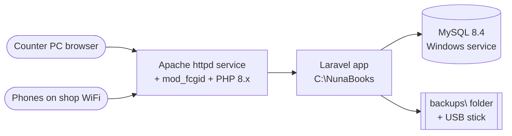
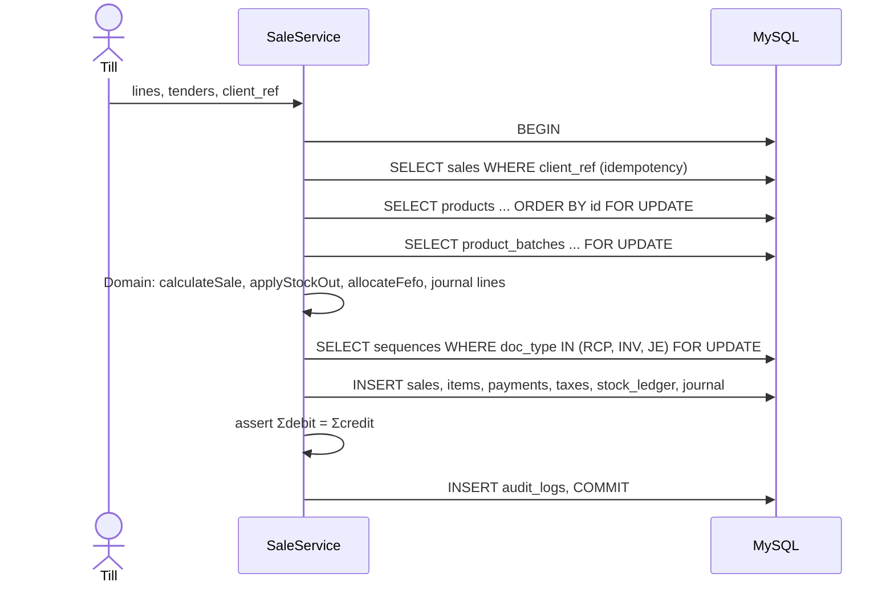

# Architecture: NunaBooks (Laravel + MySQL)

**Last updated:** 2026-11-05 · **Status:** planned. No code is written yet; [../PLAN.md](../PLAN.md) is awaiting approval.

The old app's design record (`C:\ClaudeProjects\bookkeeper\ARCHITECTURE.md`) is still the contract for **behaviour**: §3 precision, §4 double entry, §6 workflows, §7 permissions, §14 year-end close and §17 overpayment carry over unchanged. This document records only what the stack changes. Where the two disagree on a figure, the old app is right until a test proves otherwise.

## 1. Overview

A server-rendered monolith running on the shop's own Windows PC: Laravel serves Blade + Livewire screens, and MySQL 8 stores the books. Phones and a second till reach it over the shop WiFi, and no internet is needed to make a sale. One process tree, one database, no external services.

## 2. System context



## 3. Tech stack

| Layer | Choice | Reason |
|---|---|---|
| Framework | Laravel, latest stable at build time (version TBD; check its docs, not memory) | Asked for in PROMPT.md. |
| Screens | Blade + Livewire, Tailwind | Server-rendered like the old app's Server Components; no SPA build for the shop PC to run. |
| Language | PHP 8.4 (Laragon on the dev PC has 8.4.19 and 8.5.4) | 64-bit `int`; `brick/math` `BigInteger` for any multiply that could overflow. |
| Database | MySQL 8.4 LTS, InnoDB, `utf8mb4`, strict mode, `time_zone = '+00:00'` | Asked for. Enforces `CHECK` (8.0.16+). |
| Tests | Pest (or PHPUnit) against a real MySQL test database | The point is to test MySQL behaviour: locks, checks, collation. |
| Auth | Laravel session guard, custom `LegacyScrypt` verifier for imported hashes | Offline, no third party. See [../SECURITY.md](../SECURITY.md). |

## 4. Components (layering survives from the old app §2)

```
app/Http/Controllers, app/Livewire   UI only. Auth + validation + permission, then delegate. No money maths.
app/Services/                        One per old service. Opens DB::transaction, takes row locks,
                                     calls Domain, writes rows, posts the journal, writes the audit log.
app/Domain/                          Pure PHP. No DB, no clock, no I/O. Money, Quantity, Rate,
                                     TaxBreakdown, Costing (running pair), Batches (FEFO),
                                     JournalBuilder, PeriodLock, FinancialYear, BusinessDate.
app/Enums/                           One enum per CHECK list; migrations build CHECKs from them.
app/Support/Filters/                 One filter parser per module, shared by page and CSV export.
database/migrations, seeders         Schema, chart of accounts, sequences, tax components, demo data.
app/Console/Commands/                nuna:import-sqlite, nuna:reconcile, nuna:backup, nuna:restore, nuna:preflight.
```

**The rule that matters:** a financial calculation exists in `app/Domain` exactly once. Blade and Livewire never compute money; services never re-derive a total the domain already produced.

### 4.1 The UI layer (Phase 9)

How the screens sit on the services; the working rules are in [UI-CONVENTIONS.md](UI-CONVENTIONS.md).

- **Livewire full-page components** in `app/Livewire/<Module>/<Page>.php`, views in `resources/views/livewire/<module>/`, rendered inside the shell layout (`config/livewire.php`). A page parses input, calls a service, and formats the result through `App\View\Format` (`@money`, `@qty`, `@date`); no SQL, no `DB::`, no money arithmetic. Figures a page needs come from a service read (for example `SaleService::documentPayments` for the receipt and invoice lines). Record ids and slugs a page takes from its URL are `#[Locked]`.
- **Routes** live in `routes/modules/<module>.php`, one file per module, all required inside the signed-in group of `routes/web.php` (`auth`, `session.limits`, `password.chosen`). Receipts, invoices, statements, prints and file downloads are plain controllers in `app/Http/Controllers/<Module>/`.
- **Gates.** Every route carries `permission:<module>,<action>`; `RouteGuardTest` fails a route without it. Livewire actions are POSTs to `/livewire/update`, which route middleware does not cover, so every write action calls `$this->authorize('<module>.<action>')` first, and views ask the same Gate (`@can`) before offering a button.
- **One filter parser per module** in `app/Support/Filters/ListFilters.php`, shared by the page and its CSV (`GET /export/list/{list}`, `/export/report/{report}`, `ExportController`): parse once, filter in SQL before the limit, totals on the same conditions, every id, enum, date, amount and sort key validated, controls showing the resolved value, and CSV links carrying the resolved dates.
- **Components** in `resources/views/components` (`x-filter-bar`, `x-table`, `x-th`, `x-pagination`, `x-csv-button`, `x-field` with `x-input`/`x-date-input`, `x-confirm-dialog`, `x-flash`), styled with the theme tokens in `resources/css/app.css`.

Where the screens behave differently from the old app (session flashes, switch user, the native date picker, the till's server-side search, the logo behind sign-in, CSV links with resolved dates, restore staying on the command line, and the rest) is listed, with the reason, in the README table [Differences from the old app](../README.md#differences-from-the-old-app). Old behaviour kept on purpose but awaiting the owner is in [PLAN.md §10](../PLAN.md#10-owner-decisions-old-app-money-behaviour-kept-for-now).

## 5. Key flows

### Sale (one transaction, two tills at once)



Locks are always taken in the same order (products by id, then batches, then sequences) so two tills cannot deadlock each other. A deadlock or lock-wait timeout is retried a bounded number of times by `DB::transaction($fn, attempts)`; anything else rolls back with nothing saved.

### Year-end close, period lock, returns, voids

Unchanged in behaviour. See the old ARCHITECTURE.md §14, README "Closing the books", and the rules listed in [../PLAN.md](../PLAN.md).

## 6. Data

42 tables, ported one to one. Money and quantity are `BIGINT` minor units, trading dates are `DATE`, timestamps are `DATETIME(3)` UTC, no stored balances. Details and every `CHECK`: [DATA_MODEL.md](DATA_MODEL.md).

## 7. Integrations

None. The app needs no internet. Updates come from the git remote when the owner chooses (TBD: see §8).

## 8. Deployment and environments

| Env | URL | Deploy trigger |
|---|---|---|
| Dev | `http://bookkeeper-laravel.com.gh` (Laragon) or `php artisan serve` | manual |
| Test | MySQL database `nunabooks_test_run_<pid>` on the dev PC, one per run, made and dropped by the run | `php artisan test` |
| Shop PC | `http://<shop-name>` on the LAN (hosts entry + desktop shortcut, as today) | owner-run update script |

**Proposed shop install (decision pending in PLAN.md):**
- MySQL 8.4 from the official Windows ZIP, installed as a Windows service (`NunaBooksMySQL`), bound to `127.0.0.1`, random root password, app and backup users with least privilege.
- Apache httpd (Apache Lounge build) as a Windows service, with `mod_fcgid` running a pool of PHP NTS `php-cgi` workers. `php artisan serve` is ruled out for the shop: PHP's built-in server handles one request at a time on Windows, so a second till would wait on the first.
- Both services start at boot with no window and restart on failure. A PowerShell installer replaces `scripts/install.ps1` / `deploy.ps1`.
- Front-end assets are built before release and committed to the release, so the shop PC needs neither Node nor the internet.
- Update: back up, stop Apache, `git pull --ff-only`, `composer install --no-dev`, `php artisan migrate --force`, cache config/routes/views, start; roll back code and restore the backup on failure.
- Alternative: run the whole stack inside Laragon on the shop PC. Simpler to install, but it is a developer tool and does not run as a boot-time service by default.

**Backups:** `php artisan nuna:backup` runs `mysqldump --single-transaction --routines --triggers --hex-blob` (consistent while trading), gzips it, verifies by restoring into a scratch database and checking that the trial balance balances and stock matches the ledger, then trims old copies only after a verified one exists. `nuna:restore` refuses while the app is serving, verifies first and keeps the database it replaced.

## 9. Cross-cutting concerns

- **Auth and permissions:** [../SECURITY.md](../SECURITY.md).
- **Errors:** every write is one transaction, so error pages may truthfully say nothing was saved. Domain errors map to user messages; nothing internal is printed.
- **Configuration:** `.env`, see `.env.example` (to be written).
- **Testing:** domain unit tests first (ported from `tests/domain/`), then one Laravel test per old `tests/services/` file asserting the same minor-unit figures, the five invariant tests from old §9, and a two-connection concurrency test.
- **Business date:** `Africa/Accra` (UTC+0, no DST) decides "today"; ranges are inclusive on `DATE` columns; never filter trading on a timestamp.

## 10. Decisions (ADR log)

| # | Date | Decision | Alternatives considered | Rationale |
|---|---|---|---|---|
| 1 | 2026-11-05 | Integer `BIGINT` money and quantity, PHP `int` + `brick/math` | `DECIMAL`, floats | Carried over; rounding must match the old app to the pesewa. |
| 2 | 2026-11-05 | Keep the old range check (±2^53−1) on every money and quantity value | Use PHP's full 64-bit range | The old app refuses values outside the JS safe range; matching it keeps imported data and refusals identical. Proposed, pending approval. |
| 3 | 2026-11-05 | `utf8mb4_0900_bin` default collation + `LOWER()` functional unique indexes | `utf8mb4_0900_ai_ci` | Matches SQLite's binary comparison and ordering; accent-insensitive equality would change uniqueness. Proposed. |
| 4 | 2026-11-05 | Self-referencing checks (`x <> id`) as triggers | Drop them | MySQL forbids `CHECK` on an `AUTO_INCREMENT` column. |
| 5 | 2026-11-05 | Apache + mod_fcgid + MySQL services on the shop PC | Laragon, `php artisan serve`, IIS | Pending approval. |
| 6 | 2026-11-05 | Blade + Livewire | Inertia | No JS build at the shop, closest to server-rendered old app. Pending approval. |

## 11. Risks and open questions

- [ ] Laravel version to target (latest stable at build time; confirm with the owner).
- [ ] Shop install method (§8).
- [ ] `products.unit` FK `ON UPDATE CASCADE` vs MySQL's check restriction ([DATA_MODEL.md](DATA_MODEL.md) limit 4).
- [ ] `money.allocate()` turns weights into floats (`Math.round(w × 1e6)`); for weights above about 9×10⁹ pesewas that is inexact in JS. The PHP port must reproduce it bit for bit or prove the weights never get that large.
- [ ] Performance of the legacy scrypt verifier in pure PHP (one sign-in per imported user).
