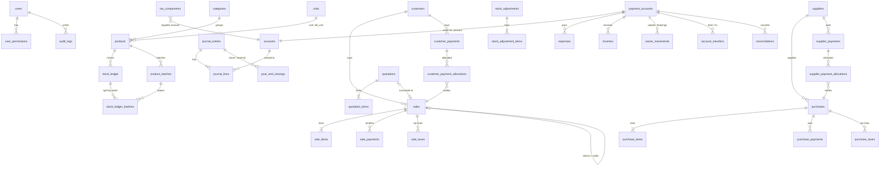

# Data Model

**Database:** MySQL 8.4 (8.0.16+ minimum for enforced `CHECK`), InnoDB, `utf8mb4`, strict SQL mode · **Schema source of truth:** `database/migrations/2026_11_05_*` · **Ported from:** the old app's 28 Drizzle migrations in `C:\ClaudeProjects\bookkeeper\src\db\migrations\` (42 tables) · **Last updated:** 2026-11-05

> Status: **built** (Phase 0). The migrations hit this target and
> `tests/Database/` proves it: every old table, CHECK and unique index is
> present (or replaced as described below), and each CHECK refuses a bad row by
> name. Where this doc and the old schema disagree, the old schema wins unless
> [../README.md](../README.md#differences-from-the-old-app) records why not.

## Type mapping rules (apply to every table)

| Old (SQLite / Drizzle) | New (MySQL) | Why |
|---|---|---|
| `id integer PK AUTOINCREMENT` | `BIGINT UNSIGNED AUTO_INCREMENT` | Laravel `id()` default. FKs `BIGINT UNSIGNED`. |
| `*_minor`, `*_milli`, `rate_bp`, `*_bp` | `BIGINT` (signed) | Money in pesewas, quantity in milli-units, rates in basis points. Never `DECIMAL`, `FLOAT`, `DOUBLE`. |
| `business_date`, `entry_date`, `expiry_date`, `received_date`, `due_date`, `valid_until`, `period_*`, `books_locked_before` (text `YYYY-MM-DD` + `GLOB` check) | `DATE` | Strict mode rejects invalid dates, which replaces the `GLOB` check. |
| `occurred_at`, `*_at` (integer ms, `timestampMs`) | `DATETIME(3)`, UTC | Importer converts ms → UTC. Connection runs with `time_zone = '+00:00'`. |
| `created_at` / `updated_at` (`unixepoch()*1000` default) | `DATETIME(3) DEFAULT CURRENT_TIMESTAMP(3)` (+ `ON UPDATE` for `updated_at`) | |
| boolean `integer` (`is_*`, `can_*`, `tax_*`, `allow_*`, `feature_*`, `adjusted`) | `TINYINT(1)` + `CHECK (col IN (0,1))` | |
| `text` | `VARCHAR(n)` for codes/names/numbers, `TEXT` for notes/memos/metadata | Lengths set per column in migrations. |
| `blob` (`logo_data`) | `MEDIUMBLOB` | Logo is capped at 1 MB; `BLOB` stops at 64 KB. |
| `CHECK(col IN (...))` | Same, as a named `CHECK` | Keep the old constraint names (`ck_<table>_<rule>`). |
| `length(x)` | `CHAR_LENGTH(x)` | `LENGTH` counts bytes in MySQL. |

### MySQL limits that force a different shape

1. **No partial indexes.** `uq_year_end_closings_open ON (start_year) WHERE reversed_at IS NULL` becomes a stored generated column `open_start_year = IF(reversed_at IS NULL, start_year, NULL)` with a `UNIQUE` index (MySQL allows many `NULL`s).
2. **Expression indexes on `lower(...)`.** MySQL will not index `LOWER()` of a column wider than 512 characters, so each becomes a stored, INVISIBLE generated column `<col>_lower` with the old index name as a UNIQUE on it: `categories.name`, `payment_accounts.name`, `products.sku`, `units.symbol`, `users.username`. MySQL's `LOWER()` folds all Unicode letters, SQLite's only ASCII (listed in the README differences).
3. **`CHECK` cannot reference an `AUTO_INCREMENT` column.** These old checks compare a column to `id` and cannot be ported as `CHECK`: `accounts.parent_id <> id`, `journal_entries.reverses_entry_id <> id`, `sales.voids_sale_id <> id`, `sales.returns_sale_id <> id`, `purchases.voids_purchase_id <> id`, `purchases.returns_purchase_id <> id`, `stock_adjustments.voids_adjustment_id <> id`. Port each as a `BEFORE UPDATE` trigger (a row cannot point at itself on insert because its id does not exist yet) plus a service assertion.
4. **`CHECK` cannot use a column that has an FK referential action.** `products.unit` and `products.alt_unit` reference `units(symbol) ON UPDATE CASCADE` and are also in checks. Proposed (PLAN.md Q6): drop the cascade and rename units in `UnitsService`, updating products in the same transaction.
5. **Collation.** SQLite compares text as binary by default, and `LIKE` is ASCII case-insensitive. Default table collation is `utf8mb4_0900_bin` (binary and NO PAD, so trailing spaces count, as in SQLite) so equality, uniqueness and `ORDER BY` match the old app; every search uses `LOWER(col) LIKE LOWER(?)` with escaped wildcards.
7. **Widths.** SQLite text has no length. Names and codes take what the old CSV import accepted (cells up to 1,000 characters): `VARCHAR(1000)` with a 191-character prefix index where the column is searched, `VARCHAR(768)` where it is part of a key (the 3,072-byte limit), `TEXT` for snapshotted line names. IP addresses and throttle keys come from request headers, so they are `TEXT` / `VARCHAR(768)`.
6. **No deferred constraints.** `Σ debit = Σ credit` per entry stays a service assertion inside the transaction, and `nuna:reconcile` checks it too.

## Entity relationship diagram

Every business table that posts money has `journal_entry_id → journal_entries.id`, and every journal entry points back with `source_type` + `source_id`.

## Entities

Columns are listed compactly: `name` type, `!` = NOT NULL, `=x` = default. Every money, quantity or rate column is `BIGINT`. Standard `created_at`/`updated_at` are omitted unless a table lacks one.

Most posting tables share this **posted-document block**: `status` `!` `='POSTED'` (`POSTED`|`VOIDED`), `journal_entry_id` FK, `voided_at`, `void_reason`, `created_by` FK users `ON DELETE SET NULL`, `is_demo` `!` `=0`, `business_date` DATE `!`, `occurred_at` DATETIME(3) `!`.

### System and security

| Table | Columns | Checks / indexes | Notes |
|---|---|---|---|
| `users` | `username`!, `display_name`!, `role`! `='STAFF'`, `password_hash`!, `pin_hash`, `is_active` `=1`, `failed_login_count` `=0`, `locked_until`, `last_login_at`, `must_change_password` `=0`, `created_by` | `role IN ('OWNER','STAFF')`; `CHAR_LENGTH(username) BETWEEN 3 AND 40`; `failed_login_count >= 0`; unique `LOWER(username)` | Never deleted, only `is_active = 0`. Hashes: imported scrypt strings kept until first successful login, then rehashed (see [../SECURITY.md](../SECURITY.md)). |
| `user_permissions` | `user_id`! FK cascade, `module`!, `can_view`, `can_create`, `can_edit`, `can_void` | `module IN (sales, purchases, inventory, products, customers, suppliers, expenses, income, accounts, reports, reconciliation, quotations, users, settings)`; unique `(user_id, module)` | |
| `sessions` | old: `id` (SHA-256 of token), `user_id`, `expires_at`, `last_seen_at`, `revoked_at`, `ip_address`, `user_agent` | | Replaced by Laravel's `sessions` table (database driver). Old rows are **not** imported; everyone signs in again after cut-over. |
| `rate_limits` | `key` PK, `attempts` `=0`, `reset_at`! | `attempts >= 0` | Kept as a table so login throttles survive restarts, as in the old app. |
| `audit_logs` | `user_id`, `username`, `action`!, `entity_type`!, `entity_id`, `summary`!, `metadata` (JSON text), `ip_address`, `user_agent`, `created_at` | `action IN (LOGIN_SUCCESS, LOGIN_FAILED, LOGOUT, CREATE, UPDATE, ARCHIVE, RESTORE, VOID, REVERSE, RECONCILE, PERMISSION_CHANGE, PASSWORD_CHANGE, SETTINGS_CHANGE, SEED_DEMO, PURGE_DEMO)`; `CHAR_LENGTH(summary) > 0` | Insert-only. New: `BEFORE UPDATE` / `BEFORE DELETE` triggers that `SIGNAL`, so the database enforces it too. |
| `business_settings` | singleton `id = 1`; `business_name` `='My Shop'`, `tagline`, `address`, `phone`, `email`, `logo_data` MEDIUMBLOB, `logo_mime`, `logo_width`, `logo_height`, `logo_updated_at`, `currency_code` `='GHS'`, `currency_symbol` `='₵'`, `tax_enabled`, `tax_rate_bp`, `tax_inclusive`, `tax_label` `='VAT'`, `low_stock_threshold_milli` `=5000`, `allow_negative_stock` `=0`, `expiry_warning_days` `=30`, `expiry_blocks_sales` `=1`, `allow_overpayment` `=0`, `default_terms_days` `=30`, `financial_year_start_month` `=1`, `books_locked_before` DATE, `look` `='default'`, `business_type` `='general_retail'`, `feature_expiry_batches` `=1`, `feature_quotations` `=0`, `has_demo_data`, `setup_completed_at` | `id = 1`; `tax_rate_bp BETWEEN 0 AND 100000`; `financial_year_start_month BETWEEN 1 AND 12`; `CHAR_LENGTH(currency_code) BETWEEN 2 AND 4`; `look IN ('default','ledger','classic')`; `business_type IN ('general_retail','building_materials','other')` | Currency code is refused once the books have entries. |
| `sequences` | `doc_type` PK, `prefix` `=''`, `next_number` `=1`, `padding` `=5` | `next_number >= 1`; `padding BETWEEN 0 AND 12` | Gap-free numbering: read with `lockForUpdate()` in the same transaction as the document. Seeded: `RCP-`, `INV-`, `SRT-`, `PUR-`, `PRT-`, `JE-` (padding 6), `RCV-`, `PAY-`, `EXP-`, `INC-`, `ADJ-`, `REC-`, `BAT-`, `QTE-`, `TRF-`. |

### Ledger

| Table | Columns | Checks / indexes | Notes |
|---|---|---|---|
| `accounts` | `code`!, `name`!, `type`!, `normal_balance`!, `parent_id`, `is_system`, `is_active` `=1`, `description`, `sort_order` | `CHAR_LENGTH(code) BETWEEN 1 AND 20`; `type IN (ASSET, LIABILITY, EQUITY, CONTRA_EQUITY, REVENUE, CONTRA_REVENUE, COGS, EXPENSE)`; `normal_balance IN (DEBIT, CREDIT)`; DEBIT for ASSET/EXPENSE/COGS/CONTRA_EQUITY/CONTRA_REVENUE, CREDIT for LIABILITY/EQUITY/REVENUE; unique `code` | `parent_id <> id` → trigger. No balance column. |
| `journal_entries` | `entry_no`!, `entry_date` DATE!, `occurred_at`!, `source_type`!, `source_id`, `memo`, `is_opening` `=0`, `is_closing` `=0`, `reverses_entry_id`, `reversed_by_entry_id`, `created_by`, `is_demo`, `created_at` | `source_type IN (SALE, SALE_RETURN, PURCHASE, PURCHASE_RETURN, CUSTOMER_PAYMENT, SUPPLIER_PAYMENT, EXPENSE, INCOME, STOCK_ADJUSTMENT, RECONCILIATION, OPENING_BALANCE, CAPITAL, DRAWINGS, TRANSFER, REVERSAL, YEAR_END_CLOSE)`; `source_id IS NOT NULL OR source_type IN ('OPENING_BALANCE','YEAR_END_CLOSE')`; unique `entry_no`; index `entry_date` | `reverses_entry_id <> id` → trigger. P&L excludes `is_closing = 1`; balance sheet includes it. |
| `journal_lines` | `entry_id`! FK cascade, `line_no`!, `account_id`!, `debit_minor` `=0`, `credit_minor` `=0`, `payment_account_id`, `customer_id`, `supplier_id`, `description`, `created_at` | `debit_minor >= 0`; `credit_minor >= 0`; exactly one non-zero; unique `(entry_id, line_no)`; index `(account_id, entry_date)` needs `entry_date` denormalised or a join | `customer_id` / `supplier_id` carry the AR/AP subledger. |
| `year_end_closings` | `start_year`!, `period_start` DATE!, `period_end` DATE!, `journal_entry_id`!, `profit_minor`!, `drawings_minor`!, `closed_by`, `closed_at`!, `reversed_at`, `reversed_by`, `reversal_entry_id` | `period_end > period_start`; reversed_at and reversal_entry_id both null or both set; unique `open_start_year` (generated) | Partial unique index replaced, see limit 1. |

### Catalog and inventory

| Table | Columns | Checks / indexes | Notes |
|---|---|---|---|
| `units` | `symbol` PK, `name`!, `decimal_places` `=0` | `CHAR_LENGTH(TRIM(symbol)) > 0`; `decimal_places BETWEEN 0 AND 3`; unique `LOWER(symbol)` | |
| `categories` | `name`!, `description`, `is_active`, `sort_order`, `is_demo` | `CHAR_LENGTH(TRIM(name)) > 0`; unique `LOWER(name)` | |
| `products` | `name`!, `sku`, `barcode`, `category_id` FK set null, `unit`! FK units, `alt_unit` FK units, `alt_factor_milli`, `alt_cost_price_minor`, `alt_selling_price_minor`, `description`, `cost_price_minor` `=0`, `selling_price_minor` `=0`, `min_stock_milli`, `warn_days`, `qty_on_hand_milli` `=0`, `stock_value_minor` `=0`, `track_inventory` `=1`, `is_active` `=1`, `created_by`, `is_demo` | alt fields all null, or `alt_unit` set with a non-null `alt_factor_milli > 0` and `alt_unit <> unit` (stricter than the old app, see README differences); alt prices `>= 0`; prices `>= 0`; `min_stock_milli`, `warn_days` null or `>= 0`; `qty_on_hand_milli <> 0 OR stock_value_minor = 0`; unique `LOWER(sku)`, unique `barcode` | `qty_on_hand_milli` / `stock_value_minor` are the running pair `(Q, V)`, a read cache of the newest `stock_ledger` row. Lock the product row (`lockForUpdate()`) before any stock movement. `alt_*` is the carton (pack) unit; it locks once stock has moved. |
| `product_batches` | `product_id`!, `batch_ref`!, `expiry_date` DATE, `received_date` DATE!, `qty_milli` `=0`, `opening_qty_milli` `=0`, `source_type`!, `source_id`, `supplier_id` set null, `warn_days`, `note`, `is_closed` `=0`, `is_demo` | `CHAR_LENGTH(TRIM(batch_ref)) > 0`; `warn_days` null or `>= 0`; `is_closed = 0 OR qty_milli = 0`; unique `batch_ref` | FEFO picking; a backdated sale only draws batches with `received_date <= business_date`. |
| `stock_ledger` | `product_id`!, `business_date` DATE!, `occurred_at`!, `movement_type`!, `source_type`!, `source_id`, `source_ref`, `qty_in_milli` `=0`, `qty_out_milli` `=0`, `unit_cost_minor` (display), `total_cost_minor` (exact), `balance_qty_milli`!, `balance_value_minor`!, `note`, `user_id`, `is_demo`, `created_at` | `movement_type IN (OPENING_STOCK, PURCHASE, PURCHASE_RETURN, SALE, SALE_RETURN, ADJUSTMENT_IN, ADJUSTMENT_OUT)`; in/out `>= 0`, exactly one positive; `balance_qty_milli <> 0 OR balance_value_minor = 0`; index `occurred_at` | Append-only. Recomputable from row 1 (`replayChain`). |
| `stock_ledger_batches` | `ledger_id`!, `batch_id`!, `qty_in_milli`, `qty_out_milli` | exactly one positive; unique `(ledger_id, batch_id)` | |
| `stock_adjustments` | `adjustment_no`!, posted-document block, `reason`!, `note`, `voided_by_adjustment_id`, `voids_adjustment_id` | `reason IN (OPENING_STOCK, DAMAGED, LOST, EXPIRED, FOUND, COUNT_CORRECTION, INTERNAL_USE, OTHER)`; unique `adjustment_no` | `voids_adjustment_id <> id` → trigger. |
| `stock_adjustment_items` | `adjustment_id`! FK cascade, `product_id`!, `direction`!, `qty_milli`!, `unit_cost_minor` `=0`, `total_cost_minor` `=0`, `batch_id`, `entry_unit`, `entry_qty_milli`, `entry_factor_milli`, `note` | `direction IN ('IN','OUT')`; `qty_milli > 0`; `total_cost_minor >= 0` | `entry_*` record what was typed (carton or base unit) and at what carton size. |

### Parties

| Table | Columns | Checks / indexes |
|---|---|---|
| `customers` | `name`!, `phone`, `email`, `address`, `notes`, `credit_limit_minor`, `is_active`, `created_by`, `is_demo` | `CHAR_LENGTH(TRIM(name)) > 0`; `credit_limit_minor` null or `>= 0` |
| `suppliers` | `name`!, `contact_person`, `phone`, `email`, `address`, `notes`, `is_active`, `created_by`, `is_demo` | `CHAR_LENGTH(TRIM(name)) > 0` |

Balances are derived from `journal_lines.customer_id` / `supplier_id`. A negative customer balance is a credit (overpayment), shown as a liability on the balance sheet.

### Sales and quotations

| Table | Columns | Checks / indexes | Notes |
|---|---|---|---|
| `sales` | `receipt_no`!, `kind` `='SALE'`, `returns_sale_id`, posted-document block, `invoice_no`, `terms_days`, `due_date` DATE, `customer_id`, `subtotal_minor`!, `discount_minor` `=0`, `tax_minor` `=0`, `total_minor`!, `tax_inclusive`, `cogs_minor` `=0`, `voided_by_sale_id`, `voids_sale_id`, `note`, `client_ref` | `kind IN ('SALE','RETURN','VOID')`; amounts all `>= 0` or all `<= 0`; `total = subtotal − discount + tax`; unique `receipt_no`, `invoice_no`, `client_ref` | `client_ref` is the idempotency key. `invoice_no` only for sales not paid in full. Returns and voids are new rows with negative amounts. |
| `sale_items` | `sale_id`! cascade, `line_no`!, `product_id`!, `product_name`!, `unit`!, `qty_milli`!, `unit_price_minor`!, `discount_minor` `=0`, `line_total_minor`!, `unit_cost_minor` `=0`, `total_cost_minor` `=0`, `returned_qty_milli` `=0`, `entry_unit`, `entry_qty_milli`, `entry_factor_milli` | `qty_milli <> 0`; `unit_price_minor >= 0`; `discount_minor >= 0`; `returned_qty_milli >= 0`; unique `(sale_id, line_no)` | Cost snapshotted at sale time. |
| `sale_payments` | `sale_id`! cascade, `payment_account_id`!, `amount_minor`!, `reference` | `amount_minor <> 0` | Split tender. |
| `sale_taxes` | `sale_id`! cascade, `component_id` set null, `code`!, `name`!, `rate_bp`!, `basis` `='NET'`, `amount_minor`! | `basis IN ('NET','NET_PLUS_LEVIES')`; unique `(sale_id, code)` | |
| `quotations` | `quote_no`!, `business_date` DATE!, `valid_until` DATE!, `customer_name`!, `customer_id` set null, `customer_phone`, `reference`, `subtotal_minor`!, `discount_minor`, `quote_discount_minor`, `tax_minor`, `total_minor`!, `tax_inclusive`, `status` `='OPEN'`, `converted_sale_id`, `converted_at`, `override_reason`, `cancelled_at`, `cancel_reason`, `notes`, `created_by`, `is_demo` | `status IN ('OPEN','CONVERTED','CANCELLED')`; `valid_until >= business_date`; amounts `>= 0`; `total = subtotal − discount + tax`; `(status = 'CONVERTED') = (converted_sale_id IS NOT NULL)`; `status = 'CANCELLED' OR cancelled_at IS NULL`; unique `quote_no`, `converted_sale_id` | Not a posting document: no journal entry. |
| `quotation_items` | `quotation_id`! cascade, `line_no`!, `product_id`!, `product_name`!, `unit`!, `qty_milli`!, `unit_price_minor`!, `discount_minor`, `line_total_minor`!, `entry_*` | `qty_milli > 0`; price and discount `>= 0` | |

### Purchases

| Table | Columns | Checks / indexes |
|---|---|---|
| `purchases` | `purchase_no`!, `kind` `='PURCHASE'`, `supplier_id`, posted-document block, `invoice_no`, `subtotal_minor`!, `discount_minor`, `tax_minor`, `total_minor`!, `returns_purchase_id`, `voids_purchase_id`, `voided_by_purchase_id`, `note` | `kind IN ('PURCHASE','RETURN','VOID')`; `total = subtotal − discount + tax`; unique `purchase_no`; self-reference checks → trigger |
| `purchase_items` | `purchase_id`! cascade, `line_no`!, `product_id`!, `product_name`!, `unit`!, `qty_milli`!, `unit_cost_minor`!, `discount_minor`, `line_total_minor`!, `returned_qty_milli`, `entry_*` | `qty_milli <> 0`; `returned_qty_milli >= 0` |
| `purchase_payments` | `purchase_id`! cascade, `payment_account_id`!, `amount_minor`!, `reference` | `amount_minor <> 0` |
| `purchase_taxes` | as `sale_taxes` plus `is_recoverable` | `basis IN ('NET','NET_PLUS_LEVIES')`; unique `(purchase_id, code)` |

### Payments

| Table | Columns | Checks / indexes |
|---|---|---|
| `customer_payments` | `payment_no`!, `customer_id`!, posted-document block, `payment_account_id`!, `amount_minor`!, `reference`, `note` | `amount_minor > 0`; unique `payment_no` |
| `customer_payment_allocations` | `payment_id`! cascade, `sale_id`!, `amount_minor`! | `amount_minor <> 0`; unique `(payment_id, sale_id)` |
| `supplier_payments` | mirror of `customer_payments` with `supplier_id` | same |
| `supplier_payment_allocations` | `payment_id`! cascade, `purchase_id`!, `amount_minor`! | same |

### Cashbook and accounts

| Table | Columns | Checks / indexes |
|---|---|---|
| `payment_accounts` | `name`!, `kind`!, `provider`, `account_number`, `gl_account_id`! FK accounts, `is_active`, `is_default`, `sort_order`, `is_demo` | `kind IN ('CASH','MOBILE_MONEY','BANK','OTHER')`; unique `LOWER(name)`, unique `gl_account_id` |
| `expenses` | `expense_no`!, posted-document block, `category_account_id`! FK accounts, `description`!, `amount_minor`!, `payment_account_id`!, `reference`, `note` | `amount_minor > 0`; non-blank description; unique `expense_no` |
| `incomes` | `income_no`!, same shape as `expenses` | same |
| `owner_movements` | `movement_no`!, `kind`!, posted-document block, `payment_account_id`!, `amount_minor`!, `description`! | `kind IN ('CAPITAL','DRAWINGS')`; `amount_minor > 0`; unique `movement_no` |
| `account_transfers` | `transfer_no`!, posted-document block, `from_account_id`!, `to_account_id`!, `amount_minor`!, `reference`, `note` | `amount_minor > 0`; `from_account_id <> to_account_id`; unique `transfer_no` |
| `reconciliations` | `reconciliation_no`!, posted-document block, `payment_account_id`!, `expected_minor`!, `actual_minor`!, `difference_minor`!, `explanation`, `adjusted` | `difference_minor = actual_minor − expected_minor`; a non-zero difference needs a non-blank explanation; unique `reconciliation_no` |

### Tax

| Table | Columns | Checks / indexes |
|---|---|---|
| `tax_components` | `code`!, `name`!, `rate_bp` `=0`, `basis` `='NET'`, `is_recoverable`, `gl_account_id`! FK accounts, `sort_order`, `is_active` | `rate_bp BETWEEN 0 AND 100000`; `basis IN ('NET','NET_PLUS_LEVIES')`; non-empty code and name; unique `code` |

Seeded: NHIL 2.5% (250 bp) → 2110, GETFund 2.5% (250 bp) → 2120, VAT 15% (1500 bp) → 2100, all on the net and active, with `business_settings.tax_enabled` off: no tax is charged until the owner turns it on. A shop that already had a single rate keeps it as VAT and gets the levies switched off. The derived `tax_rate_bp` is the all-in 2000 bp, labelled "Tax".

## Enums / lookup values

| Name | Values |
|---|---|
| `users.role` | OWNER, STAFF |
| `user_permissions.module` | sales, purchases, inventory, products, customers, suppliers, expenses, income, accounts, reports, reconciliation, quotations, users, settings |
| `accounts.type` | ASSET, LIABILITY, EQUITY, CONTRA_EQUITY, REVENUE, CONTRA_REVENUE, COGS, EXPENSE |
| `journal_entries.source_type` | SALE, SALE_RETURN, PURCHASE, PURCHASE_RETURN, CUSTOMER_PAYMENT, SUPPLIER_PAYMENT, EXPENSE, INCOME, STOCK_ADJUSTMENT, RECONCILIATION, OPENING_BALANCE, CAPITAL, DRAWINGS, TRANSFER, REVERSAL, YEAR_END_CLOSE |
| `stock_ledger.movement_type` | OPENING_STOCK, PURCHASE, PURCHASE_RETURN, SALE, SALE_RETURN, ADJUSTMENT_IN, ADJUSTMENT_OUT |
| `stock_adjustments.reason` | OPENING_STOCK, DAMAGED, LOST, EXPIRED, FOUND, COUNT_CORRECTION, INTERNAL_USE, OTHER |
| `sales.kind` / `purchases.kind` | SALE or PURCHASE, RETURN, VOID |
| document `status` | POSTED, VOIDED (quotations: OPEN, CONVERTED, CANCELLED) |
| `payment_accounts.kind` | CASH, MOBILE_MONEY, BANK, OTHER |
| tax `basis` | NET, NET_PLUS_LEVIES |
| `business_settings.look` | default, ledger, classic |
| `business_settings.business_type` | general_retail, building_materials, other |

Keep each list in one PHP enum (`app/Enums/`) and generate the `CHECK` from it in the migration, the way the old `_check.ts` built them from the TypeScript tuples.

### Chart of accounts (seeded, codes stable)

1000 Cash · 1010 Mobile Money · 1020 Bank · 1100 Accounts Receivable · 1200 Inventory · 2000 Accounts Payable · 2100 VAT Payable · 2110 NHIL Payable · 2120 GETFund Levy Payable · 3000 Owner's Capital · 3100 Owner's Drawings (contra-equity) · 3200 Retained Earnings · 3900 Opening Balance Equity · 4000 Sales Revenue · 4100 Sales Discounts · 4150 Sales Returns · 4200 Other Income (4210 Commission, 4220 Service Income, 4290 Miscellaneous Income) · 5000 Cost of Goods Sold · 5900 Inventory Shrinkage · 5910 Cash Over / Short · 6000 Operating Expenses (6010 Rent … 6110 Licences & Permits, 6900 Miscellaneous).

Default payment accounts: Cash, MTN MoMo, Bank Account. Each owns its own GL asset account.

## Data lifecycle

- **Retention:** keep everything. Nothing financial is ever deleted.
- **Soft delete:** none in the Laravel sense. Documents are voided with a linked reversal; users, products, customers, suppliers, categories and accounts are switched off with `is_active = 0`. Exception: an unused duplicate product (no movements, no lines) is deleted; a used one is archived.
- **Sensitive fields:** `users.password_hash`, `users.pin_hash`, session data, `audit_logs.ip_address` / `user_agent`, customer contact fields. See [../SECURITY.md](../SECURITY.md).
- **Seeding:** `php artisan migrate:fresh --seed` (chart of accounts, sequences, units, tax components, payment accounts); demo data only when `SEED_DEMO_DATA=true` and never in production.
- **Import:** `php artisan nuna:import-sqlite <copy of bookkeeper.db>` copies every row unchanged, converting ms timestamps to UTC `DATETIME(3)`.
